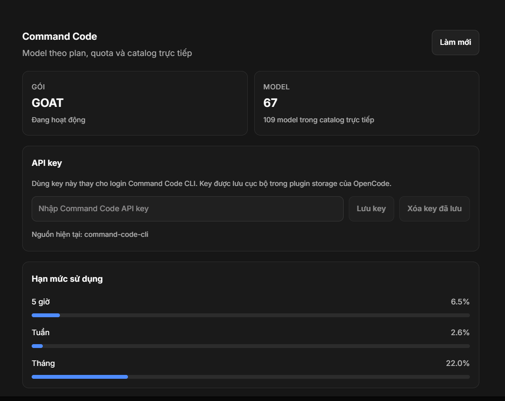

# OpenCode Command Code

Command Code (GOAT / Go / Pro / Max) provider and desktop settings page for **OpenCode v2**.

The plugin talks to Command Code the same way the DSH provider suite does:

- reads the Command Code CLI login from `~/.commandcode/auth.json`;
- reads the account plan and the live `/provider/v1/models` catalog;
- hides models the current plan cannot use (the cause of `MODEL_NOT_IN_PLAN`);
- adds new models without waiting for a models.dev update;
- exposes reasoning efforts as OpenCode model variants (`#low`, `#high`, `#max`, …);
- adds a **Settings → Command Code** page with plan, credits, usage windows, live model count and a refresh button.



## Requirements

- OpenCode **v2.2.x** (desktop or CLI)
- A Command Code account (the same account used by the Command Code CLI)
- Node 22+ only for development and the Windows installer

## Install

### Installer (Windows)

```powershell
git clone https://github.com/phuchb204/opencode-commandcode.git
cd opencode-commandcode
powershell -ExecutionPolicy Bypass -File scripts/install.ps1
```

The installer clones the plugin into `~/.config/opencode/opencode-commandcode`, backs up your global config, adds the plugin entry, and removes the old static `provider.commandcode` block. Pass `-KeepLegacyProvider` to keep the old provider. It needs Node 22+ to rewrite the JSON config.

### Manual install

```sh
git clone https://github.com/phuchb204/opencode-commandcode.git \
  ~/.config/opencode/opencode-commandcode
```

Add the absolute path to the global config:

```json
{
  "$schema": "https://opencode.ai/config.json",
  "plugins": ["/absolute/path/to/opencode-commandcode"]
}
```

OpenCode Desktop loads plugins from the **global** `~/.config/opencode/opencode.json(c)`, not from a project config.

> `opencode plugin add github:phuchb204/opencode-commandcode` currently fails in OpenCode 2.2.5's Bun installer with `NpmInstallFailedError: git dep preparation failed`. Use the installer or the manual path above until that installer is fixed.

### Remove the old static provider

If you previously connected Command Code by hand, remove the old `commandcode` provider block from `~/.config/opencode/opencode.json`:

```jsonc
{
  "provider": {
    "commandcode": {
      // delete this whole object
    }
  }
}
```

The plugin owns the provider now. Keeping the old block is not fatal, but its model list wins over parts of the provider transform and makes the picker stale.

Restart OpenCode Desktop after installing, then open **Settings → Command Code**.

## Authentication

The key is resolved in this order:

1. plugin option `apiKey`;
2. a key saved from **Settings → Command Code** (OpenCode plugin storage);
3. environment `COMMANDCODE_API_KEY` or `CMD_API_KEY`;
4. `~/.commandcode/auth.json` (Command Code CLI login);
5. an existing `commandcode` provider key already loaded by OpenCode.

The usual setup is simply being signed in to the Command Code CLI:

```sh
cmd status
```

You can also paste a key directly in **Settings → Command Code**. The plugin probes `/alpha/billing/subscriptions` before saving, so a rejected key is not stored. **Clear saved key** removes it and falls back to the CLI login or environment.

The plugin never writes the key to OpenCode's config. It is held in the plugin process and injected into the provider at runtime.

## Configuration

Options go in the object form of the plugin entry:

```jsonc
{
  "plugins": [
    {
      "package": "/absolute/path/to/opencode-commandcode",
      "options": {
        "plan": "auto",
        "includeAnthropic": false,
        "refreshIntervalMs": 300000
      }
    }
  ]
}
```

| Option | Default | Meaning |
| --- | --- | --- |
| `apiKey` | — | Explicit key; normally use the CLI login instead. |
| `authFile` | `~/.commandcode/auth.json` | Command Code CLI login file. |
| `baseURL` | `https://api.commandcode.ai` | API host, without `/provider/v1`. |
| `plan` | `auto` | `auto` reads the plan from the subscription endpoint. Can also be `go`, `goat`, `pro`, `max`. |
| `includeAnthropic` | `false` | Include Claude models through the Anthropic-compatible route. See the caveat below. |
| `includePremium` | `false` | Ignore the plan filter and expose every catalog model. |
| `include` | `[]` | If non-empty, only model IDs with one of these prefixes. |
| `exclude` | `[]` | Hide model IDs with one of these prefixes. |
| `refreshIntervalMs` | `300000` | Catalog/plan refresh interval (minimum 60s). |
| `requestTimeoutMs` | `20000` | HTTP timeout. |
| `zdr` | `false` | Send `x-cmd-zdr: 1`. |

## Models

OpenCode refers to a model as `provider/model`:

```sh
opencode run --model commandcode/gpt-6-luna "Reply with exactly: OK"
opencode run --model commandcode/deepseek/deepseek-v4-pro "Reply with exactly: OK"
```

Reasoning variants come from Command Code's `reasoningEfforts`:

```sh
opencode run --model 'commandcode/gpt-6-luna#high' "Reply with exactly: OK"
```

### Where the effort levels come from

- The **list of levels** is not hardcoded. It comes from Command Code's live catalog (`reasoningEfforts` for each model), so it changes when Command Code changes a model's ladder.
- The plugin maps those levels to OpenCode model variants (`#low`, `#high`, `#xhigh`, `#max`, …).
- The **selected level** is OpenCode state: per session/run/agent via the variant. OpenCode has no global reasoning-effort setting.
- The Command Code CLI's own `~/.commandcode/config.json` `reasoningEffort` map is **not** read by the plugin. That setting applies to `cmd` sessions only. The plugin uses OpenCode's variant selection; without a variant, the provider/model default applies.

The plugin filters in three layers:

1. **plan** — `minimumPlan` must be at or below the current plan;
2. **hidden** — entries marked `hidden` in the live catalog are skipped;
3. **explicit filters** — `include` / `exclude`.

It also reconciles model metadata (context, output, pricing, capabilities, variants) from the live catalog on every refresh.

### Claude caveat

`includeAnthropic` is **off by default** because Command Code currently returns this for Claude models, even through its own CLI:

```text
403 Forbidden
{"type":"error","error":{"type":"permission_error","message":"The provider refused this request..."}}
```

The plugin's Anthropic wiring is correct (`@opencode/ai/providers/anthropic-compatible` against `/provider/v1/messages`); the refusal is account/provider-side. Turn the option on when Command Code restores Claude access for your account.

## Desktop page

**Settings → Command Code** shows:

- API key field with **Save key** / **Clear saved key**;
- plan, status, renewal date;
- remaining credits (monthly, purchased, free);
- 5-hour, weekly and monthly usage windows as percentages;
- live catalog count and last refresh;
- model table with search, context/output limits and reasoning efforts;
- **Refresh** button.

The page uses OpenCode's experimental GUI plugin API and ships as a prebuilt CommonJS bundle (`dist/gui-experimental.cjs`).

## How it works

The server part is a normal OpenCode v2 plugin:

```ts
export default Plugin.define({
  id: "commandcode",
  async setup(ctx) {
    await ctx.provider.transform(...)   // ensure provider exists / set base URL + key
    await ctx.model.transform(...)      // remove, add and update individual models
    await ctx.rpc.register(CommandCodeRpc, { status, refresh })
  },
})
```

The important detail is that OpenCode applies config-provided provider models after plugin **provider** transforms. Replacing `editor.models.set` therefore loses to a static `provider.commandcode.models` block. The reliable seam is the later **model** transform: remove models that are not in the live catalog, update the rest, and add missing models one by one.

The GUI talks to the server through the RPC contract in `src/rpc.ts`.

## Development

```sh
npm install
npm run typecheck
npm test
npm run build
npm run check
```

Source layout:

```text
src/api.ts       Command Code HTTP client + auth resolution
src/plan.ts      plan order, labels and filtering
src/models.ts    catalog to OpenCode Model.Info mapping
src/index.ts     server plugin (transforms, refresh, RPC)
src/rpc.ts       shared RPC contract
src/gui.tsx      Settings page
scripts/         Windows installer and config registration
test/            unit tests
```

`dist/gui-experimental.cjs` is generated; rebuild it before committing a GUI change.

## Troubleshooting

**`Model unavailable: commandcode/...`**

The model is outside your plan, hidden in the catalog, or excluded by `include`/`exclude`. Check the settings page; it lists exactly what is exposed.

**`opencode models` shows old models**

The CLI's `models` command can print the static config catalog instead of the post-transform list. Use the desktop model picker or `opencode run --model ...` to test what the runtime actually resolves.

**The Settings page does not appear**

- Plugin must be in the **global** config.
- Restart OpenCode Desktop after installing.
- The server part must load successfully; check the OpenCode log.
- The GUI part is experimental; a server-side failure disables the GUI for that plugin.

**`401` / key expired**

Re-login with the Command Code CLI (`cmd status`), then press **Refresh** in Settings. The plugin re-reads `~/.commandcode/auth.json` on every refresh.

## Privacy

- The API key stays in memory and is not written to the repository or to `opencode.json`. A key entered in Settings is kept in OpenCode plugin storage (local profile data) so it survives restarts, and is removed by **Clear saved key**.
- The catalog cache is written to `~/.cache/opencode/commandcode/catalog.json` and contains no credentials.
- The GUI receives plan/usage/model data only; RPC responses never include the key.

## License

MIT
